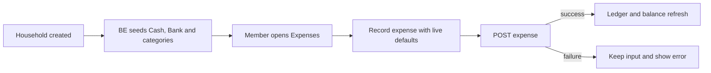
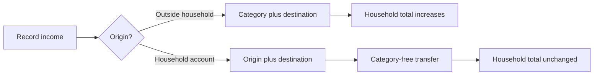
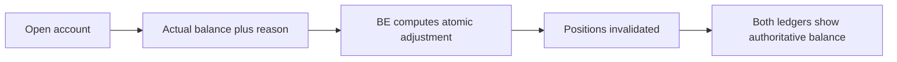

# NOSTOS UX re-audit — updated 2026-10-29

## Correction after product-owner UAT — 2026-10-29

The 2026-10-28 verdict below is historical and superseded by this section.
Source tests were incorrectly treated as sufficient to close visible and
interactive defects. In particular P1-03 (rail), P2-01 (mobile strips), P3-02
(search focus), and first-use/member-name completion must be reopened. The
screenshots supplied on October 29 establish failures that the previous audit
did not exercise. No new browser acceptance or implementation is claimed here.

### Verified owner-feedback register

| Note                                    | Status / owner                             | Evidence and required behavior                                                                                                                                                                                                                                                                                                                                                                                                                                                                                                 |
| --------------------------------------- | ------------------------------------------ | ------------------------------------------------------------------------------------------------------------------------------------------------------------------------------------------------------------------------------------------------------------------------------------------------------------------------------------------------------------------------------------------------------------------------------------------------------------------------------------------------------------------------------ |
| 1 balance excludes Cash spending        | Open, BE semantics + FE explanation        | Ledger shows Cash spending on Oct 27; account screenshot starts calculation Oct 28. `be-app/src/positions/position-query.ts` excludes expense/income dates before each account's `as_of`. This explains the displayed discrepancy if these screenshots share the account state; verify API/DB before calling it a cache defect. Implement note 15 and show the effective baseline clearly.                                                                                                                                     |
| 2 percentage direction/color            | Open, FE                                   | StripShell supports only muted/delta; falling spending is muted and rising income uses the same warning tone as spending. Use direction plus explicit percentage and meaningful colors: spending increase unfavorable, decrease favorable; income inverse; zero neutral. Verify each theme's contrast.                                                                                                                                                                                                                         |
| 3 double search focus                   | Reopened P3-02, FE                         | Screenshot 5 still has inner square outline plus outer rounded ring. Existing class assertions did not verify the rendered cascade. Inspect computed CSS in browser and retain one accessible outer focus indicator for mouse and keyboard.                                                                                                                                                                                                                                                                                    |
| 4 URL pollution                         | Confirmed, FE                              | Both filter hooks serialize the entire merged filter including default dates/page/limit/sort after a filter change. Encode only meaningful choices: month, active filters/search, nondefault page/sort. Preserve old links and custom ranges when parsing. Canonical default URLs should be `/expenses` and `/income`; historical month can be `?month=2026-09`.                                                                                                                                                               |
| 5 rail cumulative direction             | Reopened P1-03, FE display / BE totals     | ExpensesPage accumulates newest-to-active. Required: cumulative chronological spend through the active date. Oct 1 = 30k; Oct 24 = full 61,215,500 when no newer spending exists. Keep newest-first visual ordering. Never report a complete cumulative value from a partial page; obtain canonical daily/cumulative figures from BE when required.                                                                                                                                                                            |
| 6 mobile strips                         | Reopened P2-01, FE                         | Screenshot 10 confirms the 2x2 strip occupies most of the viewport and truncates copy. Use one compact horizontal swipe/scroll row with visible next-card affordance and accessible controls; no auto-advance. The ledger must be visible promptly.                                                                                                                                                                                                                                                                            |
| 7 create/edit cannot scroll             | P1, confirmed source + screenshot, FE      | Both ledgers place forms in the pinned `shrink-0` header above the only scroll container. Overflow is clipped by the app shell. Put forms in the scroll flow or a bounded scrollable editor; all fields and submit/cancel must remain reachable with the phone keyboard open.                                                                                                                                                                                                                                                  |
| 8 Expense strip composition             | Required product change, FE + BE data      | Move Remaining total balance into strip; show Total spent with previous-month comparison; retain Where it went. Proposal for the fourth metric: explicitly named `Transactions` with `5 expenses this month`, removing avg/per-day clutter. Confirm metric choice before design sign-off. Current balance must retain its own as-of date independently of selected month and filters.                                                                                                                                          |
| 9 Income strip composition              | Required product change, FE + BE aggregate | Remaining total balance; Total income; Moved between accounts with cash-withdrawal subtotal; month-over-month comparison. Remove opening-balance cell. Opening balance is a stock and previous-month income is a flow, so they are not equivalent; removing the opening cell is a hierarchy decision. BE must aggregate transfers into CASH from another household account, including cash-to-cash under the owner's stated rule, without treating them as external income.                                                    |
| 10 transfer target defaults to Bank     | Confirmed, FE                              | IncomeForm's effect selects DEFAULT_BANK for any new record with an empty destination, including transfers. Switching to transfer must clear origin/destination and must not refill them. Edit retains its saved accounts.                                                                                                                                                                                                                                                                                                     |
| 11 unchanged instead of 0%              | Confirmed, FE                              | InflowStrip substitutes `inc_vs_flat()` at zero. Show `0%` neutrally; up/down arrows only for nonzero changes. Zero prior income needs an explicit non-percentage state, not fabricated infinity.                                                                                                                                                                                                                                                                                                                              |
| 12 mobile Income hides ledger           | P1 task-access issue, FE                   | Screenshot 12 and source show strip plus full PositionCard pinned ahead of scrollable rows. Use compact swipe metrics; collapse source breakdown behind a clear disclosure, outside the pinned area; prioritize rows and capture.                                                                                                                                                                                                                                                                                              |
| 13 mobile Calendar detail unreachable   | P1 task-access issue, FE                   | DaySheet renders after MonthGrid, but CalendarPage's flex body has no `overflow-y-auto` while the shell clips overflow. Provide a scrollable page and open selected-day detail in an accessible mobile sheet or bring it into view. Preserve desktop side detail.                                                                                                                                                                                                                                                              |
| 14 Settings stops scrolling             | Confirmed, FE                              | Settings content uses `h-full` after two mobile navigation rows; their heights exceed the parent budget. Use a `min-h-0` flex column with a `flex-1 overflow-y-auto` content area and safe bottom padding. Check final accounting controls and My Account submit buttons.                                                                                                                                                                                                                                                      |
| 15 initialize default account date      | New BE business requirement + FE           | Default Cash/Bank remain protected against removal, but permit one explicit start-calculation-date assignment before the first balance correction. Date cannot be future. Existing and later-created transactions follow this lower bound. BE must expose eligibility, enforce one-time assignment and correction lock atomically, and return updated positions. Existing PATCH accepts only name/archive, so this requires a contract/schema change. Do not infer eligibility from zero balance or absence of loaded history. |
| 16 account help occupies too much space | Required FE change                         | Move protected-account and correction explanations into an info-button popover/tooltip, operable by tap, keyboard, and pointer. Keep field labels, required instructions, and errors visible. Avoid hover-only help.                                                                                                                                                                                                                                                                                                           |
| 17 correction no-op error               | Deferred by product owner, 2026-10-29      | Explicitly excluded from this implementation round. Do not change the no-op response or its presentation as part of these plans.                                                                                                                                                                                                                                                                                                                                                                                               |
| 18 member names still unsplit           | P1 integration defect, FE                  | MemberSection uses one name field; InviteInput and `toInviteBody` still send name/email and discard structured names on read. BE InviteMemberDto requires first_name/last_name/email. Split invite inputs and wire mapping, preserve structured fields in roster, and retain last-name labels with duplicate fallback. Existing test mocks accepted an obsolete contract.                                                                                                                                                      |

### FE recovery execution — 2026-10-29

FE implementation is on `fix/findings-uat`, executed inline with no subagents.
Final review fixes are committed as `36b9cf0`.
This is **implementation evidence, not browser acceptance**. Every October 29
owner finding remains visually unverified until the matrix below is executed.
Note 17 remains deferred and its no-op behavior/presentation is unchanged.

| FE scope             | Implementation evidence                                                                                                                                                                                                                                                                                                                                                                    | Browser verdict                                                                                      |
| -------------------- | ------------------------------------------------------------------------------------------------------------------------------------------------------------------------------------------------------------------------------------------------------------------------------------------------------------------------------------------------------------------------------------------ | ---------------------------------------------------------------------------------------------------- |
| Notes 6, 7, 12–14    | `36e9c73`: bounded dialog editor; incidental dismissal preserves drafts; phone metric carousel with manual controls; collapsed position detail; mobile Calendar dialog; Settings gets a bounded flex scroll region. Review fixes additionally handle visual viewport changes and restore edit-row focus.                                                                                   | Unverified at 393×852, 375×667, landscape and desktop; real keyboard not tested.                     |
| Note 18              | `f17034c`: first/last invite fields send exactly `first_name`, `last_name`, `email`; roster preserves names; legacy reads remain compatible. Mocks reject obsolete name-only requests.                                                                                                                                                                                                     | Real BE invite, duplicate-label and legacy-member journeys unverified.                               |
| Notes 1, 15, 16      | `7e47bb8`: consume `calculation_start_can_set` / `calculation_start_set_at`; explicit one-time date confirmation; household-timezone future guard; successful assignment invalidates positions. Account rows label current BE balance separately from opening metadata; accessible help replaces permanent explanation blocks. First correction refreshes account eligibility.             | Baseline reassignment, correction lock, concurrent races and live before/after positions unverified. |
| Notes 2, 5, 8, 9, 11 | `6deec62`: revised four-cell strips; current balance independently requests household-local today; canonical `daily[].cumulative`, comparison and withdrawal fields preserve server decimal strings. Rail stays visually descending; jumps beyond a page use complete BE daily counts. Missing aggregate is unavailable. Confirmed writes discard stale canonical summaries until refetch. | Real rail example, narrowed/partial datasets, every theme and all comparison states unverified.      |
| Notes 3, 4, 10       | `539701a`: default links omit defaults; historical whole months use `month`; legacy/custom ranges and meaningful settings survive. Search replaces debounce history. Composite-owned input is excluded from the global focus rule. Transfer switch clears both accounts and external-only defaults cannot refill them.                                                                     | Computed focus, browser back/forward, filter clear and real bank-to-cash submit unverified.          |

Automated FE gate: `npm run type-check`, `npm run lint`, `npm test`
(**71 files / 531 tests**) and `npm run build` pass. The build reported a
non-failing Paraglide plugin timing warning. Tests cover interactions and wire
contracts; they do not prove CSS geometry, real keyboard behavior or visual contrast.
The final author review was performed inline because the user prohibited
subagents; it provides weaker independence than a fresh reviewer.

| Joint acceptance case                                                                                                           | Executed result                                                                             |
| ------------------------------------------------------------------------------------------------------------------------------- | ------------------------------------------------------------------------------------------- |
| Create and edit expense, external income and transfer at both phone sizes; long description; keyboard; cancel/save reachability | **Unverified** — no current-build browser submission, screenshot or real keyboard evidence. |
| Phone ledger visibility, swipe/keyboard carousel, readable card copy                                                            | **Unverified** — interaction tests pass; geometry not observed.                             |
| Final Household accounting / My Account save; mobile Calendar choose/read/close and retained selection                          | **Unverified** — interaction tests pass; final browser controls not exercised.              |
| Cash Oct 28 baseline vs Oct 27 51k and Bank Oct 28 71.5k; once-only date change; future/correction lock                         | **Unverified in FE browser** — BE handoff contains read-only diagnosis, not FE acceptance.  |
| Concurrent date assignments and correction/date race                                                                            | **Unverified in FE browser** — BE e2e handoff is separate evidence.                         |
| Oct 1=30k, Oct 24=61,215,500 cumulative; scroll/click/end highlighting; filters; multiple pages                                 | **Unverified** — exact BE-shaped adapter/helper fixtures pass.                              |
| Transfer has empty accounts; Cash destination; edit saved values; neutral household total                                       | **Unverified in browser** — form/API tests pass.                                            |
| Structured member invitation, compact last name, duplicate fallback and legacy display                                          | **Unverified against live BE** — contract/component/label tests pass.                       |
| Default/cleared URL and historical month; legacy date links; browser navigation                                                 | **Unverified in browser** — parser and router-hook tests pass.                              |
| Each theme: one computed rounded search ring; semantic deltas; numeric 0%; zero prior total                                     | **Unverified** — no computed-style/theme screenshots captured.                              |
| Deferred note 17                                                                                                                | **Unchanged in source**; no live no-op correction was submitted.                            |
| Admin and member roles through the matrix                                                                                       | **Unverified** — no disposable acceptance household/session was established.                |

Browser attempt: native Chrome inspection found an existing authenticated
`localhost:6060/settings` page with the old interface, but the first inspection
took over twelve minutes. A subsequent action detected that the active window
had switched to unrelated Jira content. Automatic approval review rejected a
stale-target click and then a further tree read, to prevent unrelated interaction
or private-content access. No rejected action ran. Approval to open a dedicated
NOSTOS tab was requested; browser work remains pending that approval. The FE dev
server was started at `http://127.0.0.1:6060` after its initial sandbox socket
failure. No new screenshots or network acceptance artifacts are claimed.

BE integration prerequisite: deploy migration
`20261029000000_account_calculation_start` and the additive API contracts using
the owning BE runbook (`be-app/docs/deployment/2026-10-29-uat-recovery.md`). Its
implementation commits are `cfe4c97`, `4177380`, `b81d1e5` (handoff `2256c41`).
This FE session did not migrate, seed, reset or alter the user's DB, send a live
invite, push, merge or publish. The browser release gate remains **open**.

Execution rulings retained for handoff:

- Used the clean existing `fix/findings-uat` checkout in place; this avoids moving
  the working checkout but provides less filesystem isolation than a worktree.
- Performed author self-review because the user prohibited all subagents;
  independent reviewer blind-spot protection is absent.
- Consolidated browser checks into Task 6 after integration; this delays the
  discovery of layout defects.
- The supplied plan had no exact test commands or Expected lines; focused
  Vitest commands and the master full gate were used. An unstated check may
  remain uncovered.
- Missing new BE summary fields render unavailable during additive rollout;
  this temporarily reduces summary detail until the BE is deployed.

Deferred minors: none. Execution ledger/logs are retained in this plan's ignored
workspace so pending browser acceptance can resume without repeating tasks.

### Business decisions that must stay on BE

- Canonical account balance = opening baseline + eligible income - eligible
  expenses + corrections, respecting each account's calculation date.
- One-time start-date assignment and first-correction lock must serialize on the
  same account. Concurrent correction/date-change requests must not both succeed
  against stale eligibility. Record who changed the date and when.
- A start date alone is not an opening-balance correction. It must not silently
  alter existing amounts or create a fake income/transfer.
- Cash-withdrawal subtotal and complete cumulative day totals must be served by
  BE rather than calculated from whichever transaction page is loaded.
- The migration policy for accounts already corrected must preserve history;
  no automatic reset of correction history is authorized by these notes.

### Revised acceptance gate

1. Build a local test household with Cash/Bank and transactions both before and
   after the starting date; compare both ledgers, individual positions, and
   canonical household total. Repeat after assigning the date and correcting.
2. On 393x852 and a smaller phone, create and edit expense/income through submit,
   with keyboard open. Scroll Settings to its final action; select a Calendar
   day and read its full detail. These must be browser-executed, not class tests.
3. Confirm cumulative rail examples at Oct 1, Oct 24, and after filters, scrolling,
   search, and partial datasets. Verify clear/default and historical URLs.
4. Check desktop and phone across themes: one search focus indicator, semantic
   percentage colors, neutral 0%, swipeable metrics, and ledger visibility.
5. Invite using structured names against the live BE contract; verify last-name
   selection labels and duplicate names.

### Recommended implementation sequence

First restore reachable scroll/form/day-detail behavior and the member invite
contract. Then implement account start-date eligibility/locking on BE and consume
it in FE; verify the balance discrepancy with real response data. Next replace
strip hierarchy/mobile grids, fix rail semantics and canonical URLs, and finish
focus, comparison colors, and help/error presentation. A design checkpoint is
needed for the revised metric composition and start-date lifecycle before the
cross-stack implementation begins.

---

## Executive summary

The implementation is materially better, but the evidence does **not** support
an “all issues closed” verdict.

- **12 of 16 original findings are code-verified as resolved.**
- **1 original finding is implemented but release-blocked:** first-use defaults
  cannot be accepted in the live stack because the target DB is behind.
- **3 original findings remain open:** small touch targets, deletion/history
  copy, and locale-aware document metadata.
- Fresh verification passed for FE (66 files / 494 tests) and BE (60 unit
  suites / 415 tests; 25 e2e suites / 515 tests), plus type-check, lint, and
  builds. BE e2e still prints Jest's open-handle warning.

The largest risk is browser-verified: a valid magic-link redemption returned
HTTP 500 because the local database lacks `users.first_name`.
`prisma migrate status` reports three unapplied migrations. Until migration
and the reviewed existing-household defaults backfill are complete, the newly
implemented authenticated journeys cannot work on this database.

## Scope and evidence

The product's core job is to record all money entering, leaving, and moving
inside one family. The audit covered a member recording a purchase on a phone,
an admin recording outside income or a transfer, month/current-balance review,
household administration, and personal account settings.

Evidence labels used below:

- **Browser-verified defect:** reproduced in Chrome against FE
  `localhost:6060` and BE `localhost:4040`.
- **Code-supported concern:** directly supported by current source/tests; the
  authenticated browser journey was blocked.
- **Heuristic concern:** requires viewport/user validation.
- **Verified resolved:** supported by implementation and focused tests.

The public sign-in screen and its unknown/known-email states were exercised.
Magic-link redemption failed before session creation:

```text
PrismaClientKnownRequestError: column users.first_name does not exist
```

Read-only migration status reported:

```text
20261026000000_household_prefs_and_system_keys
20261026010000_category_free_transfers
20261026020000_member_first_last_names
```

No database reset, seed, migration, backfill, or product-code change was made.

## Route inventory

| Route                 | Purpose                                 | Re-audit evidence                                                |
| --------------------- | --------------------------------------- | ---------------------------------------------------------------- |
| `/signin`             | Request/redeem magic link               | Browser exercised through request success and redemption failure |
| `/email-change`       | Email-change status                     | Source/test reviewed                                             |
| `/expenses`           | Default landing, expense capture/review | Source/test reviewed; runtime blocked                            |
| `/income`             | Outside income, transfers, positions    | Source/test reviewed; runtime blocked                            |
| `/calendar`           | Read-only month/day overview            | Source/test reviewed; runtime blocked                            |
| `/settings` + anchors | Household Settings and My Account       | Source/test reviewed; runtime blocked                            |
| `/`, `/dashboard`     | Redirect to `/expenses`                 | Route/test reviewed                                              |
| `/financial/*`        | Legacy ledger redirects                 | Route reviewed                                                   |
| unmatched             | Not-found screen                        | Route reviewed                                                   |

Savings and Plan are disabled sidebar items, not live routes.

## Journey maps

### First expense



### Income versus transfer



### Reconciliation



## Coverage matrix

| Journey/state                       | Source/tests  | Live browser | Verdict                            |
| ----------------------------------- | ------------- | ------------ | ---------------------------------- |
| Sign-in unknown/known email         | Yes           | Yes          | Pass until redemption              |
| Magic-link redemption               | BE e2e        | Yes          | **Fail: DB schema drift**          |
| First expense/income with defaults  | Yes           | Blocked      | Code-pass, runtime unaccepted      |
| Category-free transfer              | Yes           | Blocked      | Code-pass, runtime unaccepted      |
| Failed create preserves state/cache | Yes           | Blocked      | Code-pass                          |
| Current balance on both ledgers     | Yes           | Blocked      | Code-pass                          |
| Calendar kind differentiation       | Yes           | Blocked      | Code-pass                          |
| Settings/My Account IA              | Yes           | Blocked      | Desktop model pass; mobile concern |
| Admin/member permissions            | Yes           | Blocked      | Code-pass                          |
| Sign out                            | Desktop only  | Blocked      | **Fail on mobile**                 |
| 375 px / 1440 px acceptance         | Partial tests | Blocked      | Untested                           |

## Original finding disposition

| ID                                      | Status                                             | Current evidence                                                                                |
| --------------------------------------- | -------------------------------------------------- | ----------------------------------------------------------------------------------------------- |
| P1-01 setup blocks first value          | **Implemented, release-blocked**                   | BE owns defaults and FE consumes/preselects them; target DB migrations/backfill are incomplete. |
| P1-02 transfers require income category | **Resolved**                                       | Transfer payloads send `type_id: null`; BE enforces the shape.                                  |
| P1-03 expense rail direction            | **Resolved**                                       | Newest-first rail and ledger share a cumulative-through-active-day model.                       |
| P1-04 reconciliation misses positions   | **Resolved**                                       | BE positions include adjustments; FE reconciles/invalidate only after success.                  |
| P1-05 future account baseline           | **Resolved**                                       | FE caps today and BE rejects future baselines.                                                  |
| P2-01 mobile strip loses month context  | **Resolved in code**                               | Month controls and scoped copy were reworked; exact 375 px visual acceptance remains blocked.   |
| P2-02 undersized date/month controls    | **Open**                                           | Several high-frequency controls remain 22–28 px; see P2-N03.                                    |
| P2-03 repeated expected `/prefs` 404s   | **Resolved in code**                               | Capability/endpoint and shared caching exist; target DB migration is pending.                   |
| P2-04 history promise versus deletion   | **Open**                                           | “Nothing is destroyed” remains beside Delete; confirmation says no in-app restore.              |
| P2-05 Settings grouped by feature       | **Resolved**                                       | Household Settings and My Account own stable URL anchors.                                       |
| P2-06 failed creates invalidate reads   | **Resolved**                                       | Expense/income settlement returns early on error; rollback tests pass.                          |
| P2-07 calendar kinds low-salience       | **Resolved in code**                               | Sign, label, shape/height, and semantic color are combined.                                     |
| P2-08 competing CTAs/hidden balance     | **Resolved**                                       | Expenses is default, Income has one record CTA, both ledgers show BE balance.                   |
| P3-01 title ignores English locale      | **Open**                                           | `<html lang>` changes; document title remains Indonesian.                                       |
| P3-02 double search focus               | **Resolved**                                       | One composite `focus-within` treatment.                                                         |
| P3-03 long settings plates              | **Resolved for categories; improved for accounts** | Category chips and disclosures ship; current-balance hierarchy remains open.                    |

## Open findings

### P1-N01 — Target DB schema blocks every authenticated journey

**Browser-verified defect · BE/operations owner**

A known household email received a locally suppressed magic link. Redeeming it
returned HTTP 500 because `users.first_name` is absent. Three migrations are
unapplied. Existing-household defaults also require the reviewed operational
backfill, not just the schema migration.

**Impact:** nobody using this database can sign in; defaults, transfers,
profiles, prefs, and all authenticated UX are unavailable.

**Recommendation:** back up the DB; apply migrations through the deployment
path; run and verify `prisma/backfills/2026-10-26-household-defaults.sql`
according to its README; then repeat admin/member acceptance.

**Acceptance:** redemption lands on `/expenses`; existing households gain one
protected Cash/Bank and canonical categories without overwriting custom rows;
first expense, income, transfer, and profile update complete in-browser.

### P1-N02 — Mobile users have no visible sign-out

**Code-supported concern · FE owner**

The sign-out action is inside the desktop-only sidebar
(`Sidebar.tsx:94,139-173`). The mobile avatar is non-interactive and the bottom
bar has destinations only (`Sidebar.tsx:178-201`,
`DashboardLayout.tsx:25-33`).

**Impact:** a phone-first family member cannot explicitly end a session on a
shared device.

**Recommendation:** make the mobile avatar open My Account + Sign out, or place
a visible localized Sign out in My Account, with a 44 px target.

### P1-N03 — Dirty capture forms can be dismissed without warning

**Code-supported concern · FE owner**

`useDismiss` closes on any outside pointer-down or Escape
(`useDismiss.ts:26-47`). Expense/income capture panels use the same dismissable
surface, with no dirty-state guard or confirmation.

**Impact:** a stray tap outside the form can discard a transaction after the
member has entered its amount, category, account, date, and note.

**Recommendation:** outside-click may close a pristine form, but a dirty form
must keep the draft or ask to discard. Escape should follow the same rule.

### P2-N01 — Account rows show opening balance, not current balance

**Code-supported concern · FE consuming BE positions**

`AccountSection.tsx:198-217` makes the account name primary and puts the
**opening balance** in secondary metadata. Current balance only appears after a
successful reconciliation inside the expanded panel.

**Impact:** admins can mistake a historical baseline for what an account holds.

**Recommendation:** join catalog rows to current BE positions. Render account
name left and current balance right as co-primary; retain kind, opening balance,
effective date, and protected status as metadata. Never derive balance in FE.

### P2-N02 — Delete copy contradicts the adjacent history promise

**Code-supported concern · FE content owner**

Expense/income rows say “History is kept — nothing is destroyed” beside Delete
(`ExpensePlate.tsx:267-299`, `IncomePlate.tsx:205-236`). Confirmation says the
entry changes totals/balances and cannot be restored in-app.

**Recommendation:** scope the reassurance to edit attribution or remove it from
the delete action row. Keep the confirmation explicit.

### P2-N03 — Frequent date/month controls are below 44 px

**Code-supported concern · FE owner**

- expense rail jump targets are 24×24 px (`MonthRail.tsx:96-110`);
- date-grid days are 28 px and picker arrows 24 px
  (`DateField.tsx:149-177,236-253`);
- strip month arrows shrink to 22×22 px on `sm`
  (`MonthStepper.tsx:58-67`).

**Impact:** the phone-first capture/review journey remains error-prone despite
larger primary CTAs.

**Recommendation:** preserve compact visuals with padding, but make the actual
interactive hit area at least 44×44 px.

### P2-N04 — Validation errors are announced but not tied to controls

**Code-supported concern · FE owner**

`FormField` renders an alert after the wrapped label but gives it no ID;
`AmountInput` sets `aria-invalid` without `aria-describedby`. `Select`
describes hints, but not its error. A screen reader may hear the live alert once
and then cannot recover the error from the focused field.

**Recommendation:** generate an error ID, attach it with
`aria-describedby`/Radix equivalents, and preserve the live alert.

### P2-N05 — Locale switching leaves shell/error copy inconsistent

**Code-supported concern · FE + BE copy owners**

- Skip link is hardcoded English (`DashboardLayout.tsx:15-20`).
- Document title remains Indonesian after an English switch
  (`index.html:8`, `SettingsContext.tsx:52-55`).
- English says “income categorys” (`messages/en.json:183`).
- BE's shared `INVALID_TYPE` says “Expense type…” even for income categories
  (`be-app/src/common/constants/messages.ts:5`,
  `income/income-refs.ts:124-130`).

**Recommendation:** localize shell/title and split or parameterize category
errors while BE remains the factual source.

### P2-N06 — Mobile Settings stacks two horizontal rails over a long document

**Heuristic concern · FE owner**

Mobile renders a scope rail, section rail, and vertical document
(`SettingsPage.tsx:211-253`). Five household sections plus long Indonesian
labels create hidden horizontal choices and working-memory load.

**Recommendation:** validate at 375 px after runtime restoration. Prefer one
scope control followed by a vertical section list, or one sticky section picker.

### P3-N01 — Disabled future modules occupy primary navigation

**Heuristic concern · product/FE owner**

Savings and Plan are persistent non-actions (`Sidebar.tsx:120-136`). Hide them
until usable or move roadmap communication outside operational navigation.

## Automated detector

Impeccable detector ran in **degraded regex mode** because
`htmlparser2`, `css-select`, `css-tree`, and `domutils` were unavailable.
It returned 4 warnings / 0 errors, all against generated `coverage/*.html`
artifacts (font coverage, em-dash overuse, monotonous spacing, and flat type
hierarchy), not source. They are false positives and are excluded from the
findings above. Computed contrast, custom-property, and DOM-aware checks were
therefore unavailable; the detector result is an undercount, not a clean bill.

## Positive patterns to preserve

- Expenses is the default, higher-frequency landing route.
- BE owns invariants, canonical defaults, transfer shape, effective dates,
  reconciliation, and positions; FE mirrors validation for immediate feedback.
- Both ledgers show the shared BE-derived balance; Income retains account detail.
- Direct **Add Cash** / **Add Bank Account** removes the generic Kind decision;
  protected defaults cannot be archived.
- Categories are compact semantic chips with stable icons and a custom fallback.
- Expense rows retain payer identity beside category scanning.
- Transfers are category-free and visually neutral to household wealth.
- Member selectors use last name with deterministic disambiguation.
- Failed writes preserve state and do not refetch successful-read caches.
- Calendar kinds use redundant cues and the Calendar remains read-only.
- Settings separates Household Settings from My Account.
- Routes are lazy, filters are URL-backed/debounced, rows are memoized, mocks are
  dynamically excluded from production, and locale-aware money/date formatting
  is broadly consistent.

## Recommended order

1. **Release gate:** migrate/backfill, then repeat live admin/member acceptance
   at 375 px and 1440 px.
2. Add mobile sign-out and dirty-form protection.
3. Make current account balance co-primary.
4. Increase date/month hit areas and associate validation errors.
5. Resolve delete/history and i18n/error-copy clusters.
6. Simplify mobile Settings after real viewport observation.
7. Remove or relocate disabled future modules.

## Verification record

```text
FE: type-check, lint, 66 test files / 494 tests, production build — pass
BE: type-check, lint, 60 / 415 unit, 25 / 515 e2e, build — pass
BE e2e: Jest open-handle warning remains
```

Still blocked/untested:

- authenticated browser journeys and admin/member role behavior;
- first-use completion time and request fan-out in browser tooling;
- exact 375 px / 1440 px layout, clipping, reflow, keyboard, contrast, and touch
  acceptance;
- destructive flows in the live DB;
- reconciliation visibility across both live ledger routes.

Passing source tests is strong evidence, but it is not browser acceptance.
